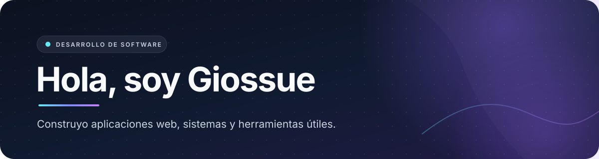

  

  
<strong>Aplicaciones web · Herramientas de escritorio · Sistemas</strong>

  
<a href="https://github.com/Giossue?tab=repositories">Explora mis repositorios</a>

---

## 👋 Sobre mí

Soy desarrollador de software y me enfoco en convertir necesidades concretas en productos digitales útiles. Me gusta trabajar de extremo a extremo: desde la estructura de una aplicación y sus datos hasta una interfaz clara y fácil de usar.

Actualmente trabajo en aplicaciones web, sistemas académicos y herramientas de escritorio para Linux. También me interesan la automatización y la inteligencia artificial aplicada a productos reales.

## 🚀 Proyectos destacados

| Proyecto | Qué hace | Tecnologías |
| --- | --- | --- |
| [Tailnet Panel](https://github.com/Giossue/tailnet-panel) | Panel de escritorio independiente para administrar Tailscale desde Linux. | Python · PyQt6 · Linux |
| [NotesIA](https://github.com/Giossue/notesIA) | Planificador estudiantil inteligente. | React Native · Bun/Hono · PostgreSQL |
| [Calidad Software](https://github.com/Giossue/calidad-software-backend) | Sistema para gestionar tutorías académicas y titulación, con API y aplicación web separadas. ([frontend](https://github.com/Giossue/calidad-software-frontend)) | Laravel · PHP · PostgreSQL |
| [Turismo Admin](https://github.com/Giossue/web-turismo-admin) | Landing institucional y panel administrativo para Turismo Vinculación. | TypeScript |

## 🧰 Tecnologías

### 💻 Frontend

   

### ⚙️ Backend y datos

     

### 🐧 Aplicaciones y herramientas

  

## 🤝 Contacto

¿Tienes una idea o quieres colaborar? [Encuéntrame en GitHub](https://github.com/Giossue) o revisa mis [repositorios](https://github.com/Giossue?tab=repositories).

  Construido con curiosidad, código y ganas de resolver problemas.

